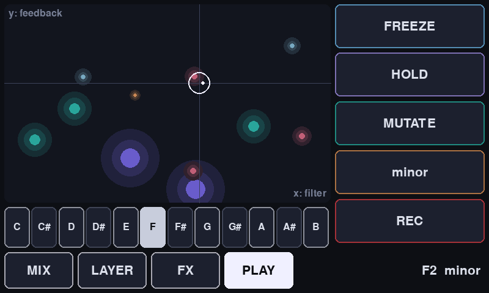
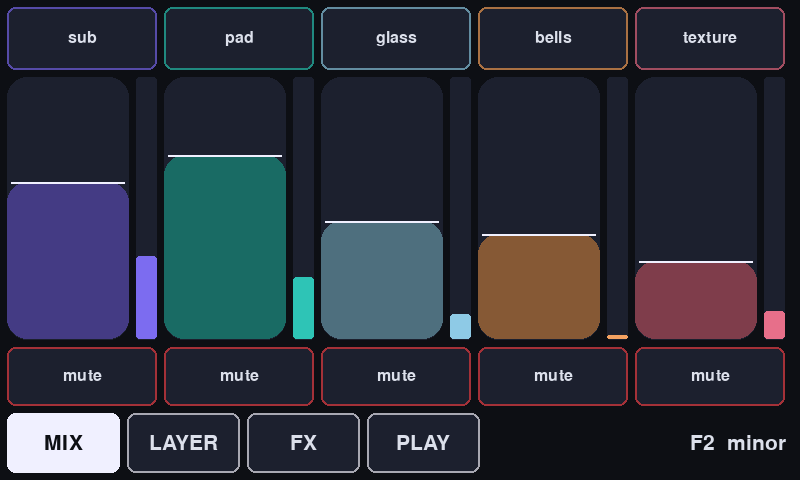
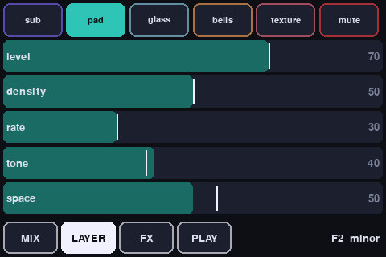
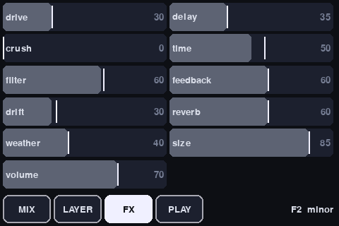

# Drone Machine

A generative drone instrument for one Raspberry Pi with an audio HAT and a touchscreen. Five
layers of sound each run their own thread, choosing notes and evolving slowly on their own. You
play it from the touchscreen: mixing the layers, sweeping an XY pad over a live view of the notes,
freezing loops, and changing the key.



## Browser version

`web/index.html` is a self-contained version that runs in any modern browser using Web Audio.
Open it, press **Start the drone**, and play. It needs no install and works offline.

It differs from the Pi engine:
- A raw **saw** layer instead of bells.
- **White noise** instead of wind in the texture layer.
- An **LFO page** with two LFOs. Each has its own destination (any layer's level, tone, pitch or space, or any effect), plus a shape (sine, triangle, saw, square, S&H, drift), a rate (0.02–20 Hz) and a depth.
- No Record button.
- Keyboard: hold space to freeze, M mutates, H toggles hold, ← → move the root.

The rest of this README covers the Raspberry Pi version.

## How it works

```
 touchscreen UI (ui/ui.py, pygame)  ──OSC──►  engine (engine/drone.scd, SuperCollider)
        ▲                                         │
        └──── state, meters, notes (10×/s) ◄──────┘
                                                  │
   sub ──┐                                        ▼
   pad ──┤ each layer: own thread + channel strip (level, mute, space)
 glass ──┼──► dry ─────────────────────────────┐
 bells ──┤                                     ├─► drive → crush → filter → limiter → audio HAT
texture ─┘──► send ─► delay (freeze) ─► reverb ┘
```

**Layers.** Each layer runs its own generative thread:

| Layer | Sound | What its thread does |
|---|---|---|
| **sub** | Deep sine and triangle | Sits on the root and fifth and moves very rarely |
| **pad** | Three drifting oscillators, sine → saw | Keeps 1–6 voices and moves one to a new note now and then |
| **glass** | High FM shimmer with tremolo | Swaps voices so notes swell in and fade out |
| **bells** | Inharmonic strikes | Plays 1–3-note strums at random intervals, which sound great into the delay |
| **texture** | Wind and tuned crackle | Plays continuously; density trades wind for crackle |

Every layer has five settings: **level**, **density** (how many voices), **rate** (how often it
changes), **tone** (dark → bright), and **space** (how much goes to the delay and reverb).

**Weather.** A built-in random walk slowly pushes the tone, space, filter, delay time and
detune around, so the piece keeps changing when you leave it alone. The `weather` slider sets how
much. On the sliders, the white line shows where the weather has pushed each value.

The UI and engine are separate programs talking OSC. That means a phone OSC app or a USB MIDI
controller can play it at the same time as the touchscreen.

## The touchscreen pages

| Page | What's on it |
|---|---|
| **MIX** | A fader, meter and mute for each layer. Tap a layer's name to edit it. |
| **LAYER** | All five settings for one layer, with a mute button |
| **FX** | Drive, crush, filter, drift (detune), weather, volume, delay, time, feedback, reverb, size |
| **PLAY** | XY pad with x = filter and y = delay feedback, drawn over glowing orbs for every playing note (height = pitch, colour = layer, size = loudness). Below it, a keyboard sets the root. On the side: **FREEZE** (on while held), **HOLD** (stops the layers changing notes), **MUTATE** (re-picks every note), the **scale** button (cycles through scales), and **REC**. |

| MIX | LAYER | FX |
|---|---|---|
|  |  |  |

The layout scales to any resolution. The screenshots are 800×480 and 480×320.

Recordings are saved as 24-bit WAVs in `~/drone-recordings/`.

## Hardware

- **Raspberry Pi 5** recommended. A Pi 3 or 4 should also cope; lower the pad density if you hear crackles.
- **Audio HAT**, for example HiFiBerry, IQaudio or Pimoroni.
- **Touchscreen**: DSI and HDMI touchscreens are the easiest. Check pin conflicts before
  stacking an SPI TFT HAT on top of an audio HAT: both want the GPIO header. Audio HATs use I2S
  (GPIO 18–21), and some SPI TFTs also use one of those pins or need the whole header. Screens
  that use every GPIO (such as DPI screens like the HyperPixel) won't work alongside an audio HAT.

## Setup

1. **OS**: flash **Raspberry Pi OS Lite (64-bit)** with Raspberry Pi Imager. Lite matters because
   the desktop's audio system (PipeWire) clashes with JACK.
2. **Audio HAT**: add your HAT's overlay to `/boot/firmware/config.txt`, as given in its docs, for
   example `dtoverlay=hifiberry-dacplus`. Reboot, then run `aplay -l` to find the card's name.
3. **Touchscreen**: install it following the vendor's instructions. DSI screens usually just work.
4. **Software**:

   ```bash
   sudo apt update
   sudo apt install -y supercollider-language supercollider-server jackd2 python3-pygame
   # answer YES when jackd2 asks about realtime priority
   sudo usermod -aG audio,video,input,render pi && sudo reboot

   cd ~/drone-machine
   python3 -m venv --system-site-packages .venv    # system-site gives it the apt pygame
   .venv/bin/pip install python-osc
   ```

5. **Run it**, using your card name from `aplay -l`:

   ```bash
   DRONE_AUDIO_DEVICE=hw:CARD=sndrpihifiberry ./run.sh
   ```

   The drone fades in over about 10 seconds. Esc or Ctrl+C stops everything.

### Start on boot

Set `DRONE_AUDIO_DEVICE` in `systemd/drone-engine.service`, then:

```bash
sudo cp ~/drone-machine/systemd/*.service /etc/systemd/system/
sudo systemctl enable --now drone-engine drone-ui
journalctl -u drone-engine -f        # engine log: root/scale changes, errors
```

### Troubleshooting

- **Touches land in the wrong place** (common on rotated screens): add `--swap-xy`, `--flip-x`
  and/or `--flip-y` to the UI command (in `run.sh` or `drone-ui.service`) until they line up.
- **Crackles or dropouts**: change `-p 256` to `-p 512` in `engine/start-engine.sh`, or lower the pad density.
- **UI says "waiting for engine..."**: check `journalctl -u drone-engine`. It usually means the
  audio device name is wrong.
- **UI appears on HDMI instead of the touchscreen**: unplug HDMI, or rotate or select the display
  in your screen's driver settings.
- **Trying the UI on a laptop**: install `pygame python-osc`, then run
  `python3 ui/ui.py --window 800x480 --engine <pi-ip>`.

## MIDI

Plug any USB MIDI controller into the Pi before starting.
- CCs 1–5 control the layer levels (sub, pad, glass, bells, texture).
- CCs 6–11 control filter, feedback, reverb, drive, weather and volume.
- Playing any note sets the root.

Edit `~ccMap` in `engine/drone.scd` to suit your controller.

## OSC reference

The engine listens on UDP port **57120**. All `/p/*` values are 0..1.

| Address | Arguments | Effect |
|---|---|---|
| `/p/<param>` | value | Global params: `volume weather drift drive crush filter delay time feedback reverb size`. Layer params: `<layer>_<level\|density\|rate\|tone\|space>`, e.g. `/p/glass_tone` |
| `/mute` | layer, 0/1 | Mute or unmute a layer |
| `/root` | MIDI note (24–60) | Set the root |
| `/root/step` | ±semitones | Move the root |
| `/scale` | index | 0 minor, 1 dorian, 2 lydian, 3 pentatonic, 4 fifths, 5 phrygian |
| `/scale/next` | – | Next scale (the chord morphs into it) |
| `/mutate` | – | Re-pick every sustained note, staggered |
| `/hold` | 0/1 | Stop or resume note changes |
| `/freeze` | 0/1 | Freeze the delay loop |
| `/record` | 0/1 | Start or stop recording |
| `/ui/hello` | port | Subscribe to state updates (`/state/*`) on that port |
